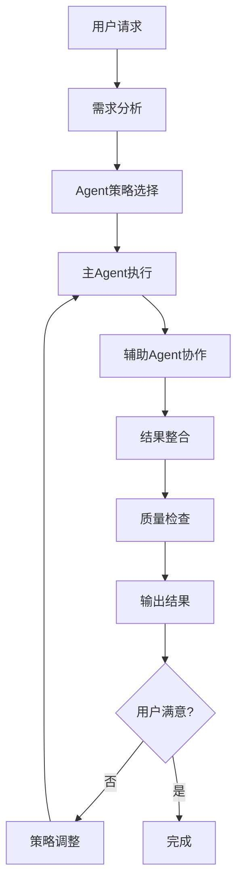

# 主控制 Agent

## 职责
作为AI编程助手的总控制器，负责协调各个专业Agent，根据用户需求选择合适的Agent组合，提供统一的编程指导和决策支持。

## 🎯 Agent架构体系

### Agent分工体系
```
主控制Agent (main-controller.md)
├── 项目结构Agent (project-structure.md)    # 项目架构和目录结构指导
├── 编码规范Agent (coding-standards.md)     # 代码规范和最佳实践
├── 代码审查Agent (code-review.md)          # 代码质量检查和审查
├── 组件开发Agent (component-development.md) # Vue组件开发指导
├── API开发Agent (api-development.md)       # API接口开发规范
├── 测试指导Agent (testing.md)              # 测试策略和用例编写
└── 部署指导Agent (deployment.md)           # 部署和运维指导
```

### Agent协作模式
- **串行协作**: 按开发流程顺序调用Agent
- **并行协作**: 同时使用多个Agent进行综合分析
- **递归协作**: Agent间相互调用和补充
- **反馈协作**: 基于结果调整Agent使用策略

## 🧠 智能决策系统

### 需求分析引擎
```typescript
/**
 * 用户需求分析接口
 */
interface IUserRequest {
  /** 请求类型 */
  type: 'create' | 'modify' | 'review' | 'debug' | 'optimize' | 'deploy';
  /** 目标文件或模块 */
  target?: string;
  /** 具体需求描述 */
  description: string;
  /** 上下文信息 */
  context?: {
    currentFile?: string;
    relatedFiles?: string[];
    errorMessage?: string;
    performanceIssue?: string;
  };
  /** 优先级 */
  priority: 'low' | 'medium' | 'high' | 'urgent';
}

/**
 * Agent选择策略
 */
interface IAgentStrategy {
  /** 主要Agent */
  primaryAgent: string;
  /** 辅助Agent列表 */
  supportAgents: string[];
  /** 执行顺序 */
  executionOrder: 'sequential' | 'parallel' | 'conditional';
  /** 预期输出类型 */
  expectedOutput: 'code' | 'documentation' | 'analysis' | 'configuration';
}
```

### 决策规则引擎
```typescript
/**
 * 主控制器决策类
 */
export class MainController {
  /**
   * 分析用户需求并选择合适的Agent策略
   */
  static analyzeRequest(request: IUserRequest): IAgentStrategy {
    const { type, target, description, context } = request;
    
    // 基于请求类型的基础策略
    const baseStrategy = this.getBaseStrategy(type);
    
    // 基于目标文件的策略调整
    const targetStrategy = this.adjustForTarget(baseStrategy, target);
    
    // 基于上下文的策略优化
    const contextStrategy = this.optimizeForContext(targetStrategy, context);
    
    return contextStrategy;
  }

  /**
   * 获取基础策略
   */
  private static getBaseStrategy(type: IUserRequest['type']): IAgentStrategy {
    const strategyMap: Record<IUserRequest['type'], IAgentStrategy> = {
      create: {
        primaryAgent: 'component-development',
        supportAgents: ['coding-standards', 'project-structure'],
        executionOrder: 'sequential',
        expectedOutput: 'code',
      },
      modify: {
        primaryAgent: 'coding-standards',
        supportAgents: ['code-review', 'component-development'],
        executionOrder: 'parallel',
        expectedOutput: 'code',
      },
      review: {
        primaryAgent: 'code-review',
        supportAgents: ['coding-standards', 'testing'],
        executionOrder: 'sequential',
        expectedOutput: 'analysis',
      },
      debug: {
        primaryAgent: 'code-review',
        supportAgents: ['testing', 'coding-standards'],
        executionOrder: 'conditional',
        expectedOutput: 'analysis',
      },
      optimize: {
        primaryAgent: 'code-review',
        supportAgents: ['coding-standards', 'deployment'],
        executionOrder: 'parallel',
        expectedOutput: 'code',
      },
      deploy: {
        primaryAgent: 'deployment',
        supportAgents: ['testing', 'code-review'],
        executionOrder: 'sequential',
        expectedOutput: 'configuration',
      },
    };

    return strategyMap[type];
  }

  /**
   * 基于目标文件调整策略
   */
  private static adjustForTarget(
    strategy: IAgentStrategy, 
    target?: string
  ): IAgentStrategy {
    if (!target) return strategy;

    const adjustedStrategy = { ...strategy };

    // Vue组件文件
    if (target.endsWith('.vue')) {
      adjustedStrategy.primaryAgent = 'component-development';
      if (!adjustedStrategy.supportAgents.includes('coding-standards')) {
        adjustedStrategy.supportAgents.push('coding-standards');
      }
    }
    
    // API相关文件
    else if (target.includes('/api/') || target.includes('api.ts')) {
      adjustedStrategy.primaryAgent = 'api-development';
      if (!adjustedStrategy.supportAgents.includes('coding-standards')) {
        adjustedStrategy.supportAgents.push('coding-standards');
      }
    }
    
    // 测试文件
    else if (target.includes('.test.') || target.includes('.spec.')) {
      adjustedStrategy.primaryAgent = 'testing';
      if (!adjustedStrategy.supportAgents.includes('code-review')) {
        adjustedStrategy.supportAgents.push('code-review');
      }
    }
    
    // 配置文件
    else if (target.includes('config') || target.includes('Dockerfile')) {
      adjustedStrategy.primaryAgent = 'deployment';
      if (!adjustedStrategy.supportAgents.includes('project-structure')) {
        adjustedStrategy.supportAgents.push('project-structure');
      }
    }
    
    // Store文件
    else if (target.includes('/store/') || target.includes('store.ts')) {
      adjustedStrategy.primaryAgent = 'coding-standards';
      if (!adjustedStrategy.supportAgents.includes('api-development')) {
        adjustedStrategy.supportAgents.push('api-development');
      }
    }

    return adjustedStrategy;
  }

  /**
   * 基于上下文优化策略
   */
  private static optimizeForContext(
    strategy: IAgentStrategy,
    context?: IUserRequest['context']
  ): IAgentStrategy {
    if (!context) return strategy;

    const optimizedStrategy = { ...strategy };

    // 有错误信息时，优先使用代码审查Agent
    if (context.errorMessage) {
      optimizedStrategy.primaryAgent = 'code-review';
      optimizedStrategy.executionOrder = 'conditional';
    }

    // 有性能问题时，添加部署Agent
    if (context.performanceIssue) {
      if (!optimizedStrategy.supportAgents.includes('deployment')) {
        optimizedStrategy.supportAgents.push('deployment');
      }
    }

    // 有相关文件时，添加项目结构Agent
    if (context.relatedFiles && context.relatedFiles.length > 0) {
      if (!optimizedStrategy.supportAgents.includes('project-structure')) {
        optimizedStrategy.supportAgents.push('project-structure');
      }
    }

    return optimizedStrategy;
  }
}
```

## 📋 使用场景和Agent选择

### 1. 新建组件场景
```yaml
场景: 创建新的Vue组件
触发条件: 用户要求创建新组件
Agent策略:
  主要Agent: component-development
  辅助Agent: [coding-standards, project-structure]
  执行顺序: 顺序执行
  
执行流程:
  1. project-structure: 确定组件放置位置和命名规范
  2. component-development: 生成组件代码和结构
  3. coding-standards: 检查代码规范和类型定义
  4. testing: 生成对应的测试用例
```

### 2. API接口开发场景
```yaml
场景: 开发新的API接口
触发条件: 用户要求创建或修改API
Agent策略:
  主要Agent: api-development
  辅助Agent: [coding-standards, testing]
  执行顺序: 顺序执行
  
执行流程:
  1. api-development: 设计接口结构和类型定义
  2. coding-standards: 确保代码规范和错误处理
  3. testing: 生成API测试用例
  4. code-review: 审查接口设计和实现
```

### 3. 代码审查场景
```yaml
场景: 代码质量检查和优化建议
触发条件: 用户提交代码审查请求
Agent策略:
  主要Agent: code-review
  辅助Agent: [coding-standards, testing, deployment]
  执行顺序: 并行执行
  
执行流程:
  1. code-review: 分析代码质量和潜在问题
  2. coding-standards: 检查编码规范遵循情况
  3. testing: 评估测试覆盖率和质量
  4. deployment: 检查部署相关配置
```

### 4. 性能优化场景
```yaml
场景: 应用性能优化
触发条件: 用户报告性能问题
Agent策略:
  主要Agent: code-review
  辅助Agent: [component-development, api-development, deployment]
  执行顺序: 条件执行
  
执行流程:
  1. code-review: 识别性能瓶颈和问题代码
  2. component-development: 优化组件渲染和状态管理
  3. api-development: 优化API调用和数据处理
  4. deployment: 优化构建配置和部署策略
```

### 5. 项目重构场景
```yaml
场景: 大规模代码重构
触发条件: 用户要求重构现有代码
Agent策略:
  主要Agent: project-structure
  辅助Agent: [coding-standards, component-development, api-development]
  执行顺序: 顺序执行
  
执行流程:
  1. project-structure: 分析现有结构并设计新架构
  2. coding-standards: 制定重构的编码规范
  3. component-development: 重构Vue组件
  4. api-development: 重构API接口
  5. testing: 更新测试用例
```

## 🔄 Agent协作流程

### 标准协作流程


### 协作通信协议
```typescript
/**
 * Agent间通信接口
 */
interface IAgentMessage {
  /** 发送方Agent */
  from: string;
  /** 接收方Agent */
  to: string;
  /** 消息类型 */
  type: 'request' | 'response' | 'notification';
  /** 消息内容 */
  payload: any;
  /** 消息ID */
  messageId: string;
  /** 时间戳 */
  timestamp: number;
}

/**
 * Agent执行结果接口
 */
interface IAgentResult {
  /** Agent名称 */
  agentName: string;
  /** 执行状态 */
  status: 'success' | 'error' | 'warning';
  /** 结果数据 */
  data: any;
  /** 错误信息 */
  error?: string;
  /** 建议和提示 */
  suggestions?: string[];
  /** 执行时间 */
  executionTime: number;
}

/**
 * 协作上下文接口
 */
interface ICollaborationContext {
  /** 用户原始请求 */
  originalRequest: IUserRequest;
  /** 当前执行阶段 */
  currentPhase: string;
  /** 已执行的Agent结果 */
  agentResults: IAgentResult[];
  /** 共享数据 */
  sharedData: Record<string, any>;
  /** 执行历史 */
  executionHistory: string[];
}
```

## 📊 质量控制和反馈

### 输出质量评估
```typescript
/**
 * 质量评估标准
 */
interface IQualityMetrics {
  /** 代码质量分数 (0-100) */
  codeQuality: number;
  /** 类型安全分数 (0-100) */
  typeSafety: number;
  /** 性能分数 (0-100) */
  performance: number;
  /** 可维护性分数 (0-100) */
  maintainability: number;
  /** 测试覆盖率 (0-100) */
  testCoverage: number;
}

/**
 * 质量控制器
 */
export class QualityController {
  /**
   * 评估Agent输出质量
   */
  static evaluateOutput(
    agentResults: IAgentResult[],
    context: ICollaborationContext
  ): IQualityMetrics {
    return {
      codeQuality: this.evaluateCodeQuality(agentResults),
      typeSafety: this.evaluateTypeSafety(agentResults),
      performance: this.evaluatePerformance(agentResults),
      maintainability: this.evaluateMaintainability(agentResults),
      testCoverage: this.evaluateTestCoverage(agentResults),
    };
  }

  /**
   * 生成改进建议
   */
  static generateImprovements(
    metrics: IQualityMetrics,
    threshold: Partial<IQualityMetrics> = {}
  ): string[] {
    const suggestions: string[] = [];
    const defaultThreshold = {
      codeQuality: 80,
      typeSafety: 90,
      performance: 75,
      maintainability: 80,
      testCoverage: 80,
    };

    const finalThreshold = { ...defaultThreshold, ...threshold };

    if (metrics.codeQuality < finalThreshold.codeQuality) {
      suggestions.push('建议优化代码结构和逻辑，提高代码质量');
    }

    if (metrics.typeSafety < finalThreshold.typeSafety) {
      suggestions.push('建议完善TypeScript类型定义，提高类型安全性');
    }

    if (metrics.performance < finalThreshold.performance) {
      suggestions.push('建议优化性能瓶颈，提高应用响应速度');
    }

    if (metrics.maintainability < finalThreshold.maintainability) {
      suggestions.push('建议改进代码组织和文档，提高可维护性');
    }

    if (metrics.testCoverage < finalThreshold.testCoverage) {
      suggestions.push('建议增加测试用例，提高测试覆盖率');
    }

    return suggestions;
  }

  private static evaluateCodeQuality(results: IAgentResult[]): number {
    // 基于代码审查Agent的结果评估
    const codeReviewResult = results.find(r => r.agentName === 'code-review');
    if (!codeReviewResult) return 70; // 默认分数

    // 根据发现的问题数量计算分数
    const issues = codeReviewResult.data?.issues || [];
    const baseScore = 100;
    const penalty = Math.min(issues.length * 5, 30); // 每个问题扣5分，最多扣30分
    
    return Math.max(baseScore - penalty, 0);
  }

  private static evaluateTypeSafety(results: IAgentResult[]): number {
    // 基于编码规范Agent的结果评估
    const codingStandardsResult = results.find(r => r.agentName === 'coding-standards');
    if (!codingStandardsResult) return 75;

    const typeIssues = codingStandardsResult.data?.typeIssues || [];
    const baseScore = 100;
    const penalty = Math.min(typeIssues.length * 10, 40);
    
    return Math.max(baseScore - penalty, 0);
  }

  private static evaluatePerformance(results: IAgentResult[]): number {
    // 基于多个Agent的性能相关建议评估
    const performanceIssues = results.reduce((acc, result) => {
      return acc + (result.data?.performanceIssues?.length || 0);
    }, 0);

    const baseScore = 100;
    const penalty = Math.min(performanceIssues * 8, 35);
    
    return Math.max(baseScore - penalty, 0);
  }

  private static evaluateMaintainability(results: IAgentResult[]): number {
    // 基于代码结构和文档质量评估
    const structureResult = results.find(r => r.agentName === 'project-structure');
    const documentationScore = structureResult?.data?.documentationScore || 70;
    const complexityScore = structureResult?.data?.complexityScore || 80;
    
    return Math.round((documentationScore + complexityScore) / 2);
  }

  private static evaluateTestCoverage(results: IAgentResult[]): number {
    // 基于测试Agent的结果评估
    const testingResult = results.find(r => r.agentName === 'testing');
    return testingResult?.data?.coveragePercentage || 0;
  }
}
```

## 🎯 使用指南

### Agent选择决策树
```
用户请求
├── 创建新功能
│   ├── Vue组件 → component-development + coding-standards
│   ├── API接口 → api-development + coding-standards
│   ├── 测试用例 → testing + code-review
│   └── 配置文件 → deployment + project-structure
├── 修改现有代码
│   ├── 功能增强 → component-development + code-review
│   ├── Bug修复 → code-review + testing
│   ├── 性能优化 → code-review + deployment
│   └── 重构代码 → project-structure + coding-standards
├── 代码审查
│   ├── 质量检查 → code-review + coding-standards
│   ├── 安全审查 → code-review + deployment
│   └── 性能分析 → code-review + component-development
└── 项目管理
    ├── 架构设计 → project-structure + coding-standards
    ├── 部署配置 → deployment + testing
    └── 文档生成 → 所有Agent协作
```

### 最佳实践建议

#### 1. Agent使用原则
- **单一职责**: 每个Agent专注于特定领域
- **协作互补**: 多个Agent协作覆盖完整需求
- **渐进优化**: 基于反馈持续改进策略
- **上下文感知**: 根据项目状态调整Agent行为

#### 2. 质量保证流程
```typescript
// 标准质量检查流程
const qualityCheckFlow = [
  'coding-standards',  // 编码规范检查
  'code-review',      // 代码质量审查
  'testing',          // 测试用例验证
  'deployment'        // 部署配置检查
];
```

#### 3. 常见问题处理
- **Agent冲突**: 通过优先级和上下文解决
- **性能问题**: 限制Agent并发数量和执行时间
- **质量不达标**: 自动触发相关Agent重新处理
- **用户不满意**: 收集反馈并调整策略

## 📈 持续改进机制

### 学习和优化
```typescript
/**
 * 学习反馈接口
 */
interface ILearningFeedback {
  /** 用户满意度 (1-5) */
  satisfaction: number;
  /** 具体反馈 */
  feedback: string;
  /** 使用的Agent策略 */
  usedStrategy: IAgentStrategy;
  /** 执行结果 */
  results: IAgentResult[];
  /** 改进建议 */
  improvements: string[];
}

/**
 * 策略优化器
 */
export class StrategyOptimizer {
  /**
   * 基于反馈优化策略
   */
  static optimizeStrategy(
    feedback: ILearningFeedback[]
  ): Map<string, IAgentStrategy> {
    const optimizedStrategies = new Map<string, IAgentStrategy>();
    
    // 分析成功案例
    const successfulCases = feedback.filter(f => f.satisfaction >= 4);
    
    // 提取成功模式
    const successPatterns = this.extractSuccessPatterns(successfulCases);
    
    // 更新策略
    for (const [pattern, strategy] of successPatterns) {
      optimizedStrategies.set(pattern, strategy);
    }
    
    return optimizedStrategies;
  }

  private static extractSuccessPatterns(
    cases: ILearningFeedback[]
  ): Map<string, IAgentStrategy> {
    // 实现成功模式提取逻辑
    return new Map();
  }
}
```

通过这个主控制Agent，可以智能地协调各个专业Agent，为用户提供最适合的AI编程解决方案，确保高质量的代码输出和优秀的开发体验。
